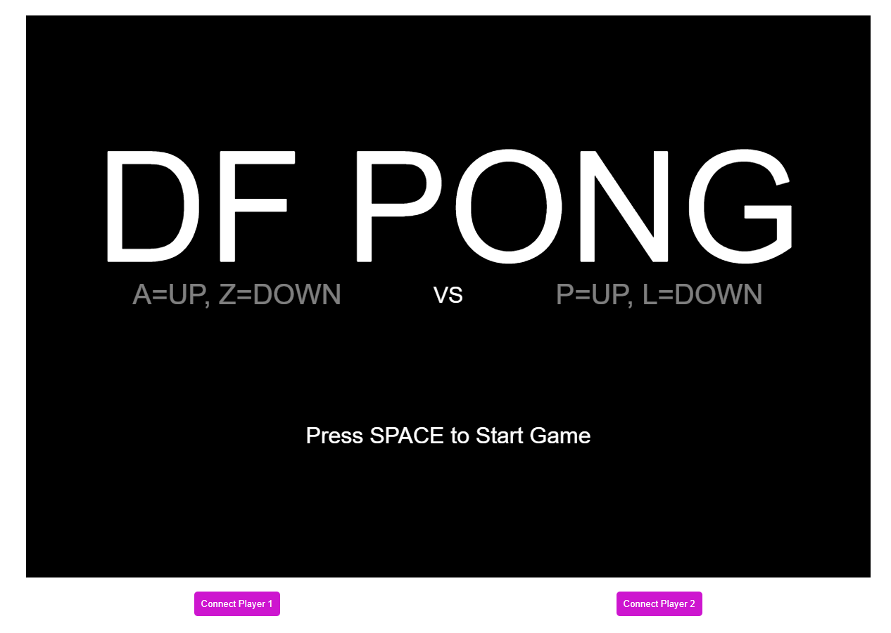

# DF Pong

**Two-player Pong in the browser, played with Bluetooth controllers you build yourself.**

Students build a controller from any sensor they like (buttons, light, distance, tilt, sound, conductive fabric…),
give it a number, and connect it to the game with one click. In 2026, controllers can also bring their own
color, sounds, paddle size and speed, and ask for the rules they'd like to play by.

## Play

| Version | | Engine |
|---|---|---|
| **CC26** · Creation & Computation 2026 | [Play](https://digitalfuturesocadu.github.io/df-pong/game/cc26/) | 2026 |
| **Controller test** · try your controller against the computer | [Open](https://digitalfuturesocadu.github.io/df-pong/game/test/) | 2026 |
| **Settings Builder** · design your custom settings, test sound addresses, get the code | [Open](https://digitalfuturesocadu.github.io/df-pong/game/builder/) | 2026 |
| **Admin panel** · change rules and run the game from another window or device | [Open](https://digitalfuturesocadu.github.io/df-pong/game/admin/) | 2026 |
| CC25 · Creation & Computation 2025 | [Play](https://digitalfuturesocadu.github.io/df-pong/game/cc25/) | 2025 (frozen) |
| PhysComp26-501 · Physical Computing 2026, section 501 | [Play](https://digitalfuturesocadu.github.io/df-pong/game/physComp26-501/) | 2025 (frozen) |
| PhysComp26-502 · Physical Computing 2026, section 502 | [Play](https://digitalfuturesocadu.github.io/df-pong/game/physComp26-502/) | 2025 (frozen) |

Controllers need **Chrome or Edge** on a computer or Android phone (Web Bluetooth). Safari, Firefox and
iPhones/iPads can still play with the keyboard, touch, or against the computer.

---

## Controllers: every year still works

| Controller | Works in the 2026 game | How to connect |
|---|---|---|
| **2026**: DFPongController library 2.x | ✓ with custom settings | Pick your number, press Connect |
| **2025**: library 1.x or the raw `DEVICE_NUMBER` sketch | ✓ | Pick your number, press Connect |
| **2024**: raw sketch with a custom name | ✓ | Choose **"2024 controller"**, then pick it by name in the browser's list |

A 2026 controller also still works in the 2025 game pages; it just plays without its custom settings.
The full protocol is in [docs/PROTOCOL.md](docs/PROTOCOL.md).

---

## For players

### 1. Build and program your controller

Install the **DFPongController** library (Arduino IDE → *Sketch → Include Library → Manage Libraries…* →
search "DFPongController"). It works on **ESP32** boards (ESP32, S3, C3, Arduino Nano ESP32; also install
*NimBLE-Arduino*) and on the **Arduino Nano 33 IoT**, Nano 33 BLE and UNO R4 WiFi.

```cpp
#include <DFPongController.h>

DFPongController controller;

void setup() {
  pinMode(2, INPUT_PULLUP);  // UP button
  pinMode(3, INPUT_PULLUP);  // DOWN button

  controller.setControllerNumber(1);   // ← your number (1–242)
  controller.setStatusLED(LED_BUILTIN);
  controller.begin();
}

void loop() {
  controller.update();                 // required every loop

  if (!digitalRead(2))      controller.sendControl(UP);
  else if (!digitalRead(3)) controller.sendControl(DOWN);
  else                      controller.sendControl(NEUTRAL);
}
```

More examples (click control, gravity, chorded buttons, live settings…) come with the library, under
*File → Examples → DFPongController*. Library repo: [df-pong-controller](https://github.com/DigitalFuturesOCADU/df-pong-controller).

### 2. Make it yours (optional)

Open the **[Settings Builder](https://digitalfuturesocadu.github.io/df-pong/game/builder/)**, choose a color,
sounds and paddle, and paste the code it gives you into `setup()` before `controller.begin()`:

```cpp
controller.setPlayerColor("#5fa36b");
controller.setHitSound("pluck");                    // a built-in sound…
controller.setScoreSound("https://raw.githubusercontent.com/you/repo/main/yay.mp3");  // …or your own
controller.setPaddleSize(120);                      // percent
controller.requestPointsToWin(7);                   // a request: your opponent may want something else
```

| Setting | What it does |
|---|---|
| `setPlayerName("…")` | Name shown in the game (up to 20 characters) |
| `setPlayerColor(r, g, b)` or `("#rrggbb")` | Your paddle and highlight color |
| `setMoveSpeed(1–100)` | How fast your paddle moves (10 is normal) |
| `setPaddleSize(50–200)` | Paddle height in percent |
| `setHitSound(…)`, `setScoreSound(…)`, `setWinSound(…)` | A built-in sound name or an `https://` address |
| `requestPointsToWin(1–21)` | Ask for a match length |
| `requestPuckSpeed(1–20)` | Ask for a starting puck speed |
| `requestSpeedIncrement(0–1)` | Ask for how much faster the puck gets per hit |

Settings can change while you play: the game picks up changes live (try mapping a sensor to your color).

**Built-in sounds:** recorded (from public archives): `pingpong`, `claves`, `tick`, `bell`, `gong`, `bikebell`, `flourish`, `applause`, `pip`, `pipgo`, `quindar`, `clock`
([credits](game/engine/2026/assets/sounds/CREDITS.md)); synthesized: `blip`, `boop`, `pluck`, `click`, `laser`,
`drum`, `chirp`, `zap`, `thud`, `wood`, `glass`, `coin`; and the originals: `classic`, `wall`, `ding`.

**Your own sound:** put a short mp3/wav/ogg (under 2 MB) in a public GitHub repo and use its
`raw.githubusercontent.com` or GitHub Pages address. The Settings Builder's **Test** button tells you if it will work.
Anything that fails to load falls back to the default sound, and the game says why.

**When players ask for different rules**, the game settles it as the match starts and shows a *Match rules*
card: by default it meets in the middle (5 and 11 → 8). The host can switch to a coin flip, lower, higher, or
lock a rule.

### 3. Connect and play

1. Open your class's game page (or the [controller test](https://digitalfuturesocadu.github.io/df-pong/game/test/)).
2. Pick your number (e.g. "12 · Kate"), press **Connect**, choose your controller in the browser's list.
3. Move your controller: your paddle moves right there in the lobby, so you can check it works.
4. Press **Start match** (or Space).

| | Keyboard | Touch |
|---|---|---|
| Player 1 | `W`/`A` up, `S`/`Z` down | drag on the left half (or the left pad on phones) |
| Player 2 | `↑`/`P` up, `↓`/`L` down | drag on the right half (or the right pad) |
| Start / pause | `Space` | ⏸ button |
| Rematch | `Space` or `Enter` | |
| Settings · controller details · mute · full screen | `C` · `D` · `M` · `F` | top-right buttons |

A player without a controller can use the keyboard or touch, or hand their side to the **computer**.

If a controller drops out mid-match (battery, interference, reset), the game pauses and reconnects to it
automatically. No need to pick it again.

### LED on the controller

| Pattern | Meaning |
|---|---|
| Slow blink | Waiting for the game |
| Fast blink | Connected, saying hello |
| Solid | Ready to play |

---

## For hosts

- **In the lobby**: the three rule tiles (points to win, puck speed, speed-up per hit) have − / + buttons.
  Click, or press and hold. If a controller's request is overriding a tile, it still shows your value ("house 10").
- **Settings panel** (the **Settings** button, the sliders icon, or `C`): match rules with locks, how
  disagreements are settled, paddle speed for each side, which customizations controllers may use, volume,
  room sound and reduced motion. On phones it opens full screen.
- **Admin panel**: everything in the settings panel plus Start/Pause/Restart, from another window or device,
  with a live view of who's connected and what settings they loaded.
  - Same computer: open the admin panel in another tab or window; it connects by itself.
  - Another device (phone, tablet, a Wi-Fi microcontroller…): run the small relay server; see
    [server/README.md](server/README.md).
- **Locked rules** ignore what players ask for. **Permissions** turn off custom names, colors, sounds, speed,
  paddle size or rule requests for everyone.

---

## How it works

### Finding the right controller in a room full of them

With 25+ controllers advertising at once, Bluetooth device names are unreliable (browsers cache them, and
many look identical). Instead, each controller advertises a **service UUID that ends with its own number**, and
the game asks the browser to show only that one:

```
19b10010-e8f2-537e-4f6c-d104768a12 + hex(13 + number)

controller 1   → …120e    (13 + 1  = 14 = 0x0e)
controller 2   → …120f    (13 + 2  = 15 = 0x0f)
controller 25  → …1226    (13 + 25 = 38 = 0x26)
controller 242 → …12ff    (13 + 242 = 255 = 0xff)
```

```javascript
navigator.bluetooth.requestDevice({ filters: [{ services: [uuid] }] });
```

The browser's chooser then lists just that controller. 2024 controllers all share suffix `14`, which is why
they're picked by name.

### Talking

| Characteristic | Direction | Content |
|---|---|---|
| Movement `19b10011-…` | controller → game | 1 byte: 0 stop, 1 up, 2 down, 3 hello |
| Config `19b10012-…` (2026) | controller → game | JSON with the player's settings, read on connect and re-read when it changes |

A short handshake (both sides send `3`) confirms a game is listening before the controller sends movement.

---

## Repository

```
game/
├── engine/2026/        the 2026 game: shared by every 2026 page (see game/README.md)
│   ├── js/             settings, ble, audio, arena, effects, render, postfx, player, game, ui, sketch
│   ├── css/
│   ├── assets/sounds/  recorded sounds + manifest.json
│   └── tests/          engine tests with simulated controllers (open in a browser)
├── cc26/               a 2026 class page: index.html + players-config.json
├── test/               controller test page (2026 engine, test mode)
├── builder/            Settings Builder
├── admin/              admin panel
├── _template/          copy this to make a new class page
└── cc25/, physComp26-501/, physComp26-502/   2025 pages, frozen as they were
server/relay.js         optional relay for the admin panel (no dependencies)
docs/PROTOCOL.md        controllers ↔ game ↔ admin, in detail
controller/examples/    raw BLE examples and sensor strategies
ble/BLE-BASICS.md       Bluetooth Low Energy primer
```

### Run it locally

```bash
node server/relay.js
```

Then open http://localhost:5501/game/cc26/. This serves the whole repo and also runs the admin relay.
Any static server works too (`python3 -m http.server`, VS Code Live Server), but without the relay.
Web Bluetooth only works on `https://` pages and `localhost`.

### Built with

- [p5.js 2.x](https://beta.p5js.org/): drawing, the frame loop, and the WebGL post-processing pass
- Web Bluetooth, Web Audio, BroadcastChannel and WebSocket browser APIs
- Based on Daniel Shiffman's [Coding Train Pong challenge](https://thecodingtrain.com/challenges/67-pong)

## License

MIT
