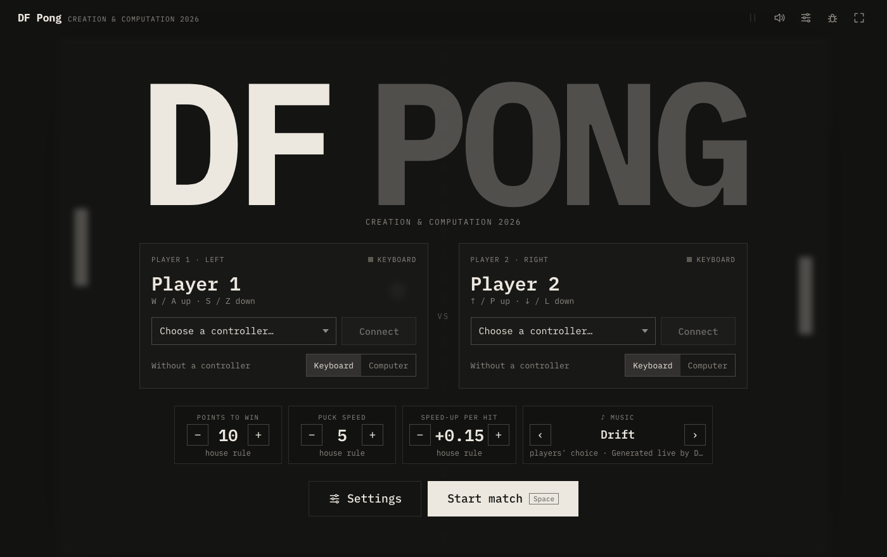

# DF Pong

**Two-player Pong in the browser, played with Bluetooth controllers you build yourself.**

Students build a controller from any sensor they like (buttons, light, distance, tilt, sound, conductive fabric…),
give it a number, and connect it to the game with one click. In 2026, controllers can also bring their own
color, sounds, music, paddle size and speed, ask for the rules they'd like to play by, and (experimental)
steer with a knob or send taunts.

## Play

| Version | | Folder |
|---|---|---|
| **CC26** · Creation & Computation 2026 | [Play](https://digitalfuturesocadu.github.io/df-pong/game/cc26/) | `game/cc26/` |
| CC26 controller test · try your controller against the computer, see its settings | [Open](https://digitalfuturesocadu.github.io/df-pong/game/cc26/?test=1) | `game/cc26/` |
| CC26 Settings Builder · design your custom settings, test sound addresses, get the code | [Open](https://digitalfuturesocadu.github.io/df-pong/game/cc26/builder/) | `game/cc26/builder/` |
| CC26 admin panel · change rules and run the game from another window or device | [Open](https://digitalfuturesocadu.github.io/df-pong/game/cc26/admin/) | `game/cc26/admin/` |
| PhysComp26-501 · Physical Computing 2026, section 501 | [Play](https://digitalfuturesocadu.github.io/df-pong/game/physComp26-501/) | `game/physComp26-501/` |
| PhysComp26-502 · Physical Computing 2026, section 502 | [Play](https://digitalfuturesocadu.github.io/df-pong/game/physComp26-502/) | `game/physComp26-502/` |
| CC25 · Creation & Computation 2025 | [Play](https://digitalfuturesocadu.github.io/df-pong/game/cc25/) | `game/cc25/` |
| Controller test (2025) | [Open](https://digitalfuturesocadu.github.io/df-pong/game/test/) | `game/test/` |

Every version lives in its own folder with its own copy of the code, so a new version never changes an older one.

Controllers need **Chrome or Edge** on a computer or Android phone (Web Bluetooth). Safari, Firefox and
iPhones/iPads can still play with the keyboard, touch, or against the computer.

---

## Controllers: every year still works

| Controller | Works in the 2026 game | How to connect |
|---|---|---|
| **2026**: DFPongController library 2.x | ✓ with custom settings (2.3 adds knob steering and taunts) | Pick your number, press Connect |
| **2025**: library 1.x or the raw `DEVICE_NUMBER` sketch | ✓ | Pick your number, press Connect |
| **2024**: raw sketch with a custom name | ✓ | Choose **"2024 controller"**, then pick it by name in the browser's list |

A 2026 controller also still works in the 2025 game pages; it just plays without its custom settings.

Everything a controller, the game and the admin panel can send each other is the **DFPONG API**:
one spec ([api/dfpong-api.json](api/dfpong-api.json)) that the game, the Arduino library, the Settings
Builder and the reference ([docs/API.md](docs/API.md)) are generated from. It's built to grow: see
[api/README.md](api/README.md). Step by step (handshake, reconnecting): [docs/PROTOCOL.md](docs/PROTOCOL.md).

---

## For players

### 1. Build and program your controller

Install the **DFPongController** library (Arduino IDE → *Sketch → Include Library → Manage Libraries…* →
search "DFPongController"). It works on **ESP32** boards (ESP32, S3, C3, Arduino Nano ESP32; also install
*NimBLE-Arduino*) and on the **Arduino Nano 33 IoT**, Nano 33 BLE and UNO R4 WiFi.

> **Nano 33 IoT: update its NINA firmware to the latest version first** (Arduino IDE 2 → *Tools → Firmware Updater* →
> pick the board → *Check Updates* → newest NINA firmware → *Install*). Its Bluetooth chip has its own firmware, and
> with an old version Bluetooth never starts: the controller doesn't appear in the browser's list and the Serial
> Monitor says `BLE failed to initialize`. You only need to do it once per board. More in the
> [library's troubleshooting](https://github.com/DigitalFuturesOCADU/df-pong-controller#troubleshooting).

#### Two ways to move your paddle

Pick the one that suits your sensor:

| | **Direction**: up, down, stop | **Position**: a height |
|---|---|---|
| Good for | Buttons, switches, tilt, claps: anything on/off | Knobs, sliders, distance, light or flex sensors: anything with a range |
| You send | `sendControl(UP)`, `sendControl(DOWN)`, `sendControl(NEUTRAL)` | `sendPosition(reading, top, bottom)` |
| The paddle | Moves while you send UP or DOWN, stops on NEUTRAL | Moves to that height and stays there |
| Works in | Every game (2024–2026) | The 2026 game, with library 2.3 or newer *(new)* |

The paddle moves at the same speed either way, so neither one is faster.

**Direction**, with two buttons (each from a pin to GND):

```cpp
#include <DFPongController.h>

DFPongController controller;

void setup() {
  pinMode(2, INPUT_PULLUP);  // UP button
  pinMode(3, INPUT_PULLUP);  // DOWN button

  controller.setControllerNumber(1);   // ← your number (1–242)
  controller.setStatusLED(LED_BUILTIN);
  controller.begin();
}

void loop() {
  controller.update();                 // required every loop

  if (!digitalRead(2))      controller.sendControl(UP);
  else if (!digitalRead(3)) controller.sendControl(DOWN);
  else                      controller.sendControl(NEUTRAL);
}
```

**Position**, with a knob (a potentiometer: outer legs to 3.3V and GND, middle leg to A0):

```cpp
#include <DFPongController.h>

DFPongController controller;

void setup() {
  controller.setControllerNumber(1);   // ← your number (1–242)
  controller.setStatusLED(LED_BUILTIN);
  controller.begin();
}

void loop() {
  controller.update();                 // required every loop

  // One end of the knob puts the paddle at the top, the other end at the bottom
  controller.sendPosition(analogRead(A0), 0, 1023);   // ESP32 boards: 0, 4095
}
```

- `sendPosition(reading, top, bottom)`: `top` is the reading that puts the paddle at the top, `bottom` the reading
  that puts it at the bottom. Any numbers work, so use the range your sensor really gives:

  ```cpp
  controller.sendPosition(analogRead(A0), 0, 1023);   // knob: 0 = top, 1023 = bottom
  controller.sendPosition(distanceCm, 5, 40);         // hand 5 cm away = top, 40 cm = bottom
  controller.sendPosition(lightLevel, 900, 100);      // bright (900) = top, dark (100) = bottom
  ```

  Swap the two numbers to turn the direction around. Readings past either end keep the paddle at that end. They're
  whole numbers (a reading of 12.7 counts as 12).
- Or send a fraction from `0.0` (top) to `1.0` (bottom): `controller.sendPosition(0.25)` is a quarter of the way down.
- Call `sendPosition()` every loop; the library only sends changes (at most every 20 ms).
- You can mix both: `sendControl(UP)` or `sendControl(DOWN)` switches back to direction (NEUTRAL doesn't), and the
  next `sendPosition()` switches to position again. `stopPosition()` also goes back to direction.
- Older games don't understand positions, so a position-only controller can't move there.

Both come with the library as examples: **01_SimpleDigital** (two buttons) and **09_KnobSteering** (a knob, library
2.3.1). More examples (click control, gravity, chorded buttons, live settings, a knob with a taunt button…) are under
*File → Examples → DFPongController*. Library repo:
[df-pong-controller](https://github.com/DigitalFuturesOCADU/df-pong-controller).

### 2. Make it yours (optional)

There are two kinds of customization. Both need the 2026 game; older games ignore them, and your controller still
plays there.

- **Settings** describe your side: name, color, paddle, sounds, music, and the rules you'd like to play by. Set them
  once in `setup()` (before or after `controller.begin()`), or change them any time while you play.
- **In Game Actions** are things you do during play, like taunting the other player. *(Experimental.)*

You need the DFPongController library **2.0 or newer** for settings, **2.1** for music and **2.3** for In Game Actions
(update it in the Library Manager).

**Easiest start:** open the **[Settings Builder](https://digitalfuturesocadu.github.io/df-pong/game/cc26/builder/)**.
It previews your paddle, plays the built-in sounds, tests your own sound links exactly the way the game loads them,
and writes the code for you. Paste it into `setup()`:

```cpp
controller.setControllerNumber(12);

controller.setPlayerColor("#5fa36b");               // green paddle
controller.setHitSound("pluck");                    // a built-in sound…
controller.setScoreSound("https://raw.githubusercontent.com/you/repo/main/yay.mp3");  // …or your own file
controller.setPaddleSize(120);                      // 20% taller
controller.requestPointsToWin(7);                   // a request: your opponent may want something else

controller.begin();
```

#### Your side: settings and their defaults

Anything you don't set uses the default. To go back to the default later, pass `""` (for names, colors and sounds).

| Function | What it changes | Default | You can use |
|---|---|---|---|
| `setControllerName("Thunderpaddle")` | Your controller's name in the game | The controller name from the class list; if there isn't one, your own name from the class list | Up to 20 characters. The name you set on the board comes first. Library 2.4+; older versions call it `setPlayerName()` |
| `setPlayerColor("#5fa36b")` or `(95, 163, 107)` | Your paddle, its trail and your highlights | Off-white (both players start the same) | Any color: `"#rrggbb"`, a name like `"orange"`, or red, green, blue (0–255). Very dark colors are brightened so you can still see them |
| `setMoveSpeed(14)` | How fast your paddle moves | 10 (the host can change each side's default) | 1–100 |
| `setPaddleSize(120)` | Paddle height, in percent | 100 | 50–200 |
| `setHitSound("pluck")` | Sound when your paddle hits the puck | `pingpong`, a recorded ball hit that rises in pitch as the rally speeds up | A built-in sound or your own file. Plays for up to 1.2 s |
| `setScoreSound("bell")` | Sound when you score | `bell` (each side's bell rings a different note) | Built-in or your own. Up to 2.5 s |
| `setWinSound("applause")` | Sound when you win | `flourish` (a band's fanfare), then applause | Built-in or your own. Up to 8 s; the applause still follows |
| `setMusic("nightbus")` | Background music for your matches | Whatever the room plays (*Drift* if nobody chooses) | A track name or your own music link |

#### Sounds: built-in, or your own file

**Built-in sounds** always work. Some are recordings from public archives (e.g. `pingpong`, `bell`, `bikebell`;
[credits](game/cc26/assets/sounds/CREDITS.md)), some are made by the game (e.g. `pluck`, `laser`, `coin`), and three
are the 2024 originals (`classic`, `wall`, `ding`). Every name is listed in [docs/API.md](docs/API.md#built-in-sounds),
and you can hear them all in the Settings Builder. Names don't care about upper or lower case.

**Your own sound file**, step by step:

1. Make or find a **short** sound: mp3, wav or ogg, under 2 MB. A hit sound should be under a second.
2. Put it in a **public GitHub repository** (on GitHub: *Add file → Upload files*).
3. Open the file on GitHub, click **Raw**, and copy the address. It starts with
   `https://raw.githubusercontent.com/…`. (A GitHub Pages address, `https://you.github.io/repo/boing.mp3`, works too.)
4. Paste the address into the Settings Builder and press **Test**. It tells you whether the game can load it.
5. Use it in your code:

   ```cpp
   controller.setHitSound("https://raw.githubusercontent.com/you/repo/main/boing.mp3");
   ```

The rules: the address must start with `https://`, point straight at the file (not a page that shows it), be at most
200 characters, and load within 8 seconds. Links from Google Drive, Dropbox, OneDrive or iCloud **don't work**: those
sites don't let other pages load their files. If a sound can't be loaded, the game plays the default instead and your
player card in the lobby says why. (Some hosts let the game play a file but not change it; it then plays without the
pitch and stereo effects, and the card mentions that.)

#### Music

`controller.setMusic("nightbus")` picks the music for your matches: one of the game's tracks (some are generated live
and pick up energy as a rally builds, e.g. `drift`, `nightbus`; others are recordings from public archives, e.g.
`gymnopedie`; [credits](game/cc26/assets/music/CREDITS.md); all names in [docs/API.md](docs/API.md#music)), or a
link to your own music file. Music links follow the sound-link rules, except they can be bigger than 2 MB (music is
streamed).

By default the room plays *Players' choice*: if one player brought music it plays, and if both did, the two picks
**alternate each point**. Whoever is at the computer can instead pick one player's music, any track, or Off, on the
lobby's ♪ Music tile or in Settings.

#### Rule requests

These ask for a shared rule, so your opponent may ask for something else:

| Function | Range | Default (the room's house rule) |
|---|---|---|
| `requestPointsToWin(7)` | 1–21 | 10 |
| `requestPuckSpeed(6.5)` | 1–20 | 5 |
| `requestSpeedIncrement(0.2)` | 0–1 | 0.15 extra speed per hit |

The defaults are the usual house rules; your class's page or the host may use others (they're shown on the lobby's
rule tiles). The game settles requests when a match starts and shows them on a *Match rules* card:

- If the host **locked** a rule, the host's value is used.
- If only you asked, you get it. If nobody asked, the house rule is used.
- If both players asked for different values, the game **meets in the middle** by default (5 and 11 → 8). The host
  can switch to a coin flip, the lower value, the higher value, or ignoring requests.

#### Changing settings while you play

Call any of the functions above at any time, for example to map a sensor to your color (see the library's
`07_LiveSettings` example). The library only sends real changes, at most 4 times a second.

During a match, the host decides when your changes apply (Settings → *When a controller changes its settings during
a match*):

- **Between points** (the default): color, name and sounds change at once; paddle speed and size wait for the next serve.
- **Right away**: everything changes at once, even mid-rally.
- **Next match**: nothing changes until the match is over.

The game shows a short message when a change has to wait. Rule requests and music always wait for the next match.

#### In Game Actions *(experimental, library 2.3)*

```cpp
controller.sendTaunt(2);   // "GG" pops up beside your paddle
```

`sendTaunt(n)` shows a word beside your paddle with a ring and a sound (your own hit sound, if you set one):

| `n` | 0 | 1 | 2 | 3 | 4 | 5 |
|---|---|---|---|---|---|---|
| Word | HA! | NICE | GG | OOPS | COME ON | WOW |

- The game shows at most **one taunt every 2 seconds** per player and ignores the rest (they don't queue up).
- Nothing happens while the game is paused, and the host can turn taunts off with the **In Game Actions** switch.
- `controller.actionsAvailable()` tells you whether the game is listening (older games don't).
- The library's `08_PositionControl` example has a knob for steering and a button for taunts.

Steering with a knob or sensor is one of the two ways to move your paddle: see
[Two ways to move your paddle](#two-ways-to-move-your-paddle) above.

#### What the host can turn off

In Settings (and the admin panel) the host can turn off, for everyone: custom names, colors, sounds, music, paddle
speed, paddle size, rule requests and **In Game Actions** (taunts; steering with a knob always works). All are on by default. When one is off, the game uses the default and
your player card shows that setting crossed out.

#### Checking what the game received

- Your **player card** in the lobby lists what your controller asked for, crosses out anything the host turned off,
  and says when a sound or music link couldn't load.
- **Controller details** (press `D`) shows the exact settings your controller sent, whether you're steering by
  position, and the actions received.
- On the controller: `Serial.println(controller.getSettingsJSON());` prints what the game will receive. Values out of
  range are fixed for you, with a note in the Serial Monitor, e.g.
  `DFPong: setMoveSpeed(500) is out of range (1-100), using 100`.

### 3. Connect and play

1. Open your class's game page (or the [controller test](https://digitalfuturesocadu.github.io/df-pong/game/cc26/?test=1)).
2. On your side of the lobby, choose **Controller** (the others are **Keyboard**, or **Touch** on phones, and **Computer**). Pick your number (e.g. "12 · Kate — Thunderpaddle"), press **Connect**, and choose your controller in the browser's list.
3. Move your controller: your paddle moves right there in the lobby, so you can check it works.
4. Press **Start match** (or Space).

| | Keyboard | Touch |
|---|---|---|
| Player 1 | `W`/`A` up, `S`/`Z` down | drag on the left half (or the left pad on phones) |
| Player 2 | `↑`/`P` up, `↓`/`L` down | drag on the right half (or the right pad) |
| Start / pause | `Space` | ⏸ button |
| Rematch | `Space` or `Enter` | |
| Settings · controller details · mute · full screen | `C` · `D` · `M` · `F` | top-right buttons |

A player without a controller can use the keyboard or touch, or hand their side to the **computer**, with a
difficulty slider from 1 (Easy) to 10 (Expert).

Every match starts with **NAME vs NAME**, using each controller's name (Space skips it).
Before any point that can end the match, the game stops for a moment and announces **MATCH POINT** across the
table, with the name of the player who can win (or *Next point wins* when both can).

Controllers can change their settings while connected. The host decides what happens during a match
(Settings → *When a controller changes its settings during a match*): **Right away**, **Between points**
(the default: looks and sounds change at once, paddle speed and size at the next serve), or **Next match**.

Running more than one game at once? Give each a **table name** (Settings → Admin panel) and one admin
panel can run them all; see [server/README.md](server/README.md).

The game checks every connected controller every couple of seconds. If one drops out mid-match (a loose
wire, a flat battery, a reset), the game pauses, says which controller disconnected, and reconnects to it
automatically. No need to pick it again. If it can't come back, the pause screen offers **Reconnect** or
**Finish on the keyboard**.

### LED on the controller

| Pattern | Meaning |
|---|---|
| Slow blink | Waiting for the game |
| Fast blink | Connected, saying hello |
| Solid | Ready to play |

---

## For hosts

- **In the lobby**: the three rule tiles (points to win, puck speed, speed-up per hit) have − / + buttons.
  Click, or press and hold. If a controller's request is overriding a tile, it still shows your value ("house 10").
  The ♪ Music tile steps through the music choices.
- **Settings panel** (the **Settings** button, the sliders icon, or `C`): match rules with locks, how
  disagreements are settled, paddle speed for each side, which customizations controllers may use, when their
  changes apply during a match, music and its volume, volume, room sound, reduced motion, and this game's table
  name. On phones it opens full screen.
- **Admin panel**: house rules with locks, how disagreements are settled, music, permissions and when live
  changes apply, plus Start / Pause / Resume / Restart / Back to lobby, from another window or device, with a
  live view of who's connected and what settings they loaded. With several games in one room, send to all of
  them or to one table, and name each table.
  - Same computer: open the admin panel in another tab or window; it connects by itself.
  - Another device (phone, tablet, a Wi-Fi microcontroller…): run the small relay server; see
    [server/README.md](server/README.md).
- **Locked rules** ignore what players ask for. **Permissions** turn off custom names, colors, sounds, music,
  speed, paddle size, rule requests or In Game Actions (taunts) for everyone.

---

## How it works

### Finding the right controller in a room full of them

With 25+ controllers advertising at once, Bluetooth device names are unreliable (browsers cache them, and
many look identical). Instead, each controller advertises a **service UUID that ends with its own number**, and
the game asks the browser to show only that one:

```
19b10010-e8f2-537e-4f6c-d104768a12 + hex(13 + number)

controller 1   → …120e    (13 + 1  = 14 = 0x0e)
controller 2   → …120f    (13 + 2  = 15 = 0x0f)
controller 25  → …1226    (13 + 25 = 38 = 0x26)
controller 242 → …12ff    (13 + 242 = 255 = 0xff)
```

```javascript
navigator.bluetooth.requestDevice({ filters: [{ services: [uuid] }] });
```

The browser's chooser then lists just that controller. 2024 controllers all share suffix `14`, which is why
they're picked by name.

### Talking

| Characteristic | Direction | Content |
|---|---|---|
| Movement `19b10011-…` | both ways | 1 byte: 0 stop, 1 up, 2 down, 3 hello. The game also reads it every 1.5 s to check the controller is still there |
| Config `19b10012-…` (2026) | controller → game | JSON with the player's settings, read on connect and re-read when it changes |
| Actions `19b10013-…` (2026, experimental) | controller → game | Small packets for things that happen during play: steer to a position, taunt |

A short handshake (both sides send `3`) confirms a game is listening before the controller sends movement.
Every setting, name and packet is listed in [docs/API.md](docs/API.md).

---

## Repository

```
game/
├── cc26/               Creation & Computation 2026: the whole 2026 game (see game/README.md)
│   ├── index.html      page settings (title, instance id, admin relay…)
│   ├── players-config.json   class list: each person and their controller's name
│   ├── js/             api (generated), settings, ble, audio, music, arena, effects, render, postfx, player, game, ui, sketch
│   ├── css/
│   ├── assets/         recorded sounds and music, with manifest.json and CREDITS.md
│   ├── builder/        Settings Builder
│   ├── admin/          admin panel
│   └── tests/          engine tests with simulated controllers (open in a browser)
├── physComp26-501/, physComp26-502/, cc25/   earlier versions, each self-contained
├── test/, _template/   the 2025 controller test page and template
└── builder/, admin/    forward old links to cc26/builder/ and cc26/admin/
server/relay.js         optional relay for the admin panel (no dependencies)
api/                    the DFPONG API spec and build.mjs, which generates the files below from it
docs/API.md             the API reference (generated)
docs/PROTOCOL.md        controllers ↔ game ↔ admin, step by step
controller/examples/    raw BLE examples and sensor strategies
ble/BLE-BASICS.md       Bluetooth Low Energy primer
```

### Run it locally

```bash
node server/relay.js
```

Then open http://localhost:5501/game/cc26/. This serves the whole repo and also runs the admin relay.
Any static server works too (`python3 -m http.server`, VS Code Live Server), but without the relay.
Web Bluetooth only works on `https://` pages and `localhost`.

- **Tests**: open http://localhost:5501/game/cc26/tests/ (simulated controllers, no hardware needed).
- **After editing the API spec** (`api/dfpong-api.json`): run `node api/build.mjs`; see [api/README.md](api/README.md).

### Built with

- [p5.js 2.x](https://beta.p5js.org/): drawing, the frame loop, and the WebGL post-processing pass
- Web Bluetooth, Web Audio, BroadcastChannel and WebSocket browser APIs
- Based on Daniel Shiffman's [Coding Train Pong challenge](https://thecodingtrain.com/challenges/67-pong)

## License

MIT
