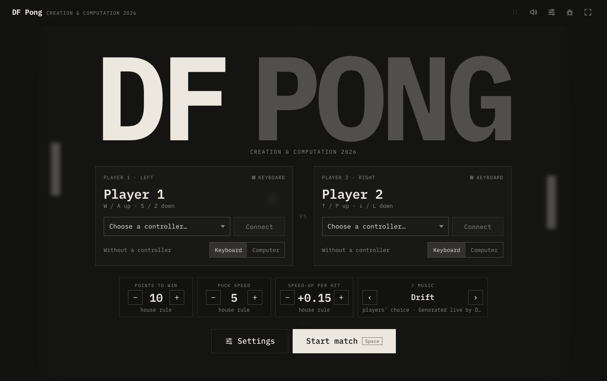

# DF Pong

**Two-player Pong in the browser, played with Bluetooth controllers you build yourself.**

Students build a controller from any sensor they like (buttons, light, distance, tilt, sound, conductive fabric…),
give it a number, and connect it to the game with one click. In 2026, controllers can also bring their own
color, sounds, music, paddle size and speed, ask for the rules they'd like to play by, and (experimental)
steer with a knob.

**Contents**

- **Playing:** [Play](#play) · [Build a controller](#build-a-controller) · [Connect and play](#connect-and-play)
- **Customizing:** [Your settings](#customize-your-controller) · [Colors](#colors) · [Built-in sounds](#built-in-sounds) · [Make your own sound](#make-your-own-sound-file) · [Music](#music) · [Rule requests](#rule-requests) · [Buzzer and game events](#a-buzzer-and-game-events-on-your-board)
- **When something's wrong:** [Troubleshooting](#troubleshooting)
- **Running a session:** [For hosts](#for-hosts)
- **Under the hood:** [Older controllers](#controllers-every-year-still-works) · [How it works](#how-it-works) · [Repository](#repository)

## Play

| Version | | Folder |
|---|---|---|
| **CC26** · Creation & Computation 2026 | [Play](https://digitalfuturesocadu.github.io/df-pong/game/cc26/) | `game/cc26/` |
| CC26 controller test · try your controller against the computer, see its settings | [Open](https://digitalfuturesocadu.github.io/df-pong/game/cc26/?test=1) | `game/cc26/` |
| CC26 Settings Builder · design your custom settings, test sound addresses, get the code | [Open](https://digitalfuturesocadu.github.io/df-pong/game/cc26/builder/) | `game/cc26/builder/` |
| CC26 admin panel · change rules and run the game from another window or device | [Open](https://digitalfuturesocadu.github.io/df-pong/game/cc26/admin/) | `game/cc26/admin/` |
| **ITP 2026** | [Play](https://digitalfuturesocadu.github.io/df-pong/game/itp26/) · [Admin panel](https://digitalfuturesocadu.github.io/df-pong/game/itp26/admin/) | `game/itp26/` |
| PhysComp26-501 · Physical Computing 2026, section 501 | [Play](https://digitalfuturesocadu.github.io/df-pong/game/physComp26-501/) | `game/physComp26-501/` |
| PhysComp26-502 · Physical Computing 2026, section 502 | [Play](https://digitalfuturesocadu.github.io/df-pong/game/physComp26-502/) | `game/physComp26-502/` |
| CC25 · Creation & Computation 2025 | [Play](https://digitalfuturesocadu.github.io/df-pong/game/cc25/) | `game/cc25/` |
| Controller test (2025) | [Open](https://digitalfuturesocadu.github.io/df-pong/game/test/) | `game/test/` |

Every version lives in its own folder with its own copy of the code, so a new version never changes an older one.

Controllers need **Chrome or Edge** on a computer or Android phone (Web Bluetooth). Safari, Firefox and
iPhones/iPads can still play with the keyboard, touch, or against the computer.

---

## Build a controller

**1. Install the library.** In the Arduino IDE: *Sketch → Include Library → Manage Libraries…*, search
"DFPongController", and install it.

| Board | Also needs |
|---|---|
| ESP32, ESP32-S3, ESP32-C3, Arduino Nano ESP32, Adafruit Feather ESP32 V2 | The *NimBLE-Arduino* library, version 2.x (same Library Manager) |
| Arduino Nano 33 IoT | The latest NINA firmware (below) |
| Arduino Nano 33 BLE, UNO R4 WiFi | Nothing else |

> **Nano 33 IoT: update its NINA firmware to the latest version first** (Arduino IDE 2 → *Tools → Firmware Updater* →
> pick the board → *Check Updates* → newest NINA firmware → *Install*). Its Bluetooth chip has its own firmware, and
> with an old version Bluetooth never starts: the controller doesn't appear in the browser's list and the Serial
> Monitor says `BLE failed to initialize`. You only need to do it once per board. More in the
> [library's troubleshooting](https://github.com/DigitalFuturesOCADU/df-pong-controller#troubleshooting).

**2. Get your number.** Every controller has its own number from 1 to 242. Your class's list gives you yours;
it's how the game finds your controller in a room full of them.

**3. Choose how you'll move your paddle** (below), set your number in the code, and upload it.

**4. Check it** on the [controller test page](https://digitalfuturesocadu.github.io/df-pong/game/cc26/?test=1): you play
against the computer, and it shows what your controller is sending.

### Two ways to move your paddle

Pick the one that suits your sensor:

| | **Direction**: up, down, stop | **Position**: a height |
|---|---|---|
| Good for | Buttons, switches, tilt, claps: anything on/off | Knobs, sliders, distance, light or flex sensors: anything with a range |
| You send | `sendControl(UP)`, `sendControl(DOWN)`, `sendControl(NEUTRAL)` | `sendPosition(reading, top, bottom)` |
| The paddle | Moves while you send UP or DOWN, stops on NEUTRAL | Moves to that height and stays there |
| Works in | Every game (2024–2026) | The 2026 game, with library 2.3 or newer *(new)* |

The paddle moves at the same speed either way, so neither one is faster.

**Direction**, with two buttons (each from a pin to GND):

```cpp
#include <DFPongController.h>

DFPongController controller;

void setup() {
  pinMode(2, INPUT_PULLUP);  // UP button
  pinMode(3, INPUT_PULLUP);  // DOWN button

  controller.setControllerNumber(1);   // ← your number (1–242)
  controller.setStatusLED(LED_BUILTIN);
  controller.begin();
}

void loop() {
  controller.update();                 // required every loop

  if (!digitalRead(2))      controller.sendControl(UP);
  else if (!digitalRead(3)) controller.sendControl(DOWN);
  else                      controller.sendControl(NEUTRAL);
}
```

**Position**, with a knob (a potentiometer: outer legs to 3.3V and GND, middle leg to A0):

```cpp
#include <DFPongController.h>

DFPongController controller;

void setup() {
  controller.setControllerNumber(1);   // ← your number (1–242)
  controller.setStatusLED(LED_BUILTIN);
  controller.begin();
}

void loop() {
  controller.update();                 // required every loop

  // One end of the knob puts the paddle at the top, the other end at the bottom
  controller.sendPosition(analogRead(A0), 0, 1023);   // ESP32 boards: 0, 4095
}
```

- `sendPosition(reading, top, bottom)`: `top` is the reading that puts the paddle at the top, `bottom` the reading
  that puts it at the bottom. Any numbers work, so use the range your sensor really gives:

  ```cpp
  controller.sendPosition(analogRead(A0), 0, 1023);   // knob: 0 = top, 1023 = bottom
  controller.sendPosition(distanceCm, 5, 40);         // hand 5 cm away = top, 40 cm = bottom
  controller.sendPosition(lightLevel, 900, 100);      // bright (900) = top, dark (100) = bottom
  ```

  Swap the two numbers to turn the direction around. Readings past either end keep the paddle at that end. They're
  whole numbers (a reading of 12.7 counts as 12).
- Or send a fraction from `0.0` (top) to `1.0` (bottom): `controller.sendPosition(0.25)` is a quarter of the way down.
- Call `sendPosition()` every loop; the library only sends changes (at most every 20 ms).
- You can mix both: `sendControl(UP)` or `sendControl(DOWN)` switches back to direction (NEUTRAL doesn't), and the
  next `sendPosition()` switches to position again. `stopPosition()` also goes back to direction.
- Older games don't understand positions, so a position-only controller can't move there.

### Examples that come with the library

They're under *File → Examples → DFPongController*:

| Folder | Examples |
|---|---|
| Pong 2026 | **dfPongStarterButtons** (two buttons), **dfPongStarterLight** (a light sensor sets the height), **dfPongGameEvents** (a buzzer and game events). The two starters are written for the Adafruit Feather ESP32 V2 |
| Pong 2025 | **00_StartTemplate**, **01_SimpleDigital** (two buttons), **02_ClickDetection**, **03_ChordedInputs**, **04_GravityClick**, **05_SlotMachine**, **06_CustomSettings**, **07_LiveSettings**, **09_KnobSteering** (a knob) |

Library repo: [df-pong-controller](https://github.com/DigitalFuturesOCADU/df-pong-controller).

### LED on the controller

| Pattern | Meaning |
|---|---|
| Slow blink | Waiting for the game |
| Fast blink | Connected, saying hello |
| Solid | Ready to play |
| 3 quick blinks, then a pause | Bluetooth didn't start: the Serial Monitor says what to do (library 2.4.3+) |

---

## Connect and play

1. Open your class's game page (or the [controller test](https://digitalfuturesocadu.github.io/df-pong/game/cc26/?test=1)).
2. On your side of the lobby, choose **Controller** (the others are **Keyboard**, or **Touch** on phones, and **Computer**). Pick your number (e.g. "12 · Kate — Thunderpaddle"), press **Connect**, and choose your controller in the browser's list. If your number isn't listed, choose **Another number…**.
3. Move your controller: your paddle moves right there in the lobby, so you can check it works.
4. Press **Start match** (or Space).

Next players? **Change players** goes back to the lobby. Pick someone else in the dropdown (the last controller
disconnects by itself) and press **Connect**.

| | Keyboard | Touch |
|---|---|---|
| Player 1 | `W`/`A` up, `S`/`Z` down | drag on the left half (or the left pad on phones) |
| Player 2 | `↑`/`P` up, `↓`/`L` down | drag on the right half (or the right pad) |
| Start / pause | `Space` | ⏸ button |
| Rematch | `Space` or `Enter` | |
| Settings · controller details · mute · full screen | `C` · `D` · `M` · `F` | top-right buttons |

A player without a controller can use the keyboard or touch, or hand their side to the **computer**, with a
difficulty slider from 1 (Easy) to 10 (Expert).

**During a match:**

- Every match starts with **NAME vs NAME**, using each controller's name (Space skips it).
- Before any point that can end the match, the game stops for a moment and announces **MATCH POINT** across the
  table, with the name of the player who can win (or *Next point wins* when both can).
- The game checks every connected controller every couple of seconds. If one drops out (a loose wire, a flat battery,
  a reset), the game pauses, says which controller disconnected, and reconnects to it automatically. If it can't come
  back, the pause screen offers **Reconnect** or **Finish on the keyboard**.

---

## Customize your controller

Everything here is optional, and needs the 2026 game. Older games ignore it, and your controller still plays there.

**Easiest start:** the **[Settings Builder](https://digitalfuturesocadu.github.io/df-pong/game/cc26/builder/)** previews
your paddle, plays every built-in sound, tests your own sound links exactly the way the game loads them, and writes
the code for you.

Settings go in `setup()`, before or after `controller.begin()`:

```cpp
controller.setControllerNumber(12);

controller.setPlayerColor("#5fa36b");               // green paddle
controller.setHitSound("pluck");                    // a built-in sound…
controller.setScoreSound("https://raw.githubusercontent.com/you/repo/main/yay.mp3");  // …or your own file
controller.setPaddleSize(120);                      // 20% taller
controller.requestPointsToWin(7);                   // a request: your opponent may want something else

controller.begin();
```

### All your settings

Anything you don't set uses the default. To go back to the default later, pass `""` (for names, colors and sounds).
Numbers outside the range are moved to the nearest allowed value, with a note in the Serial Monitor.

| Function | What it changes | Default | Options | Library |
|---|---|---|---|---|
| `setControllerName("Thunderpaddle")` | Your controller's name in the game | The class list's controller name, then your name | Up to 20 characters. The name on the board comes first | 2.4 (before that: `setPlayerName()`) |
| `setPlayerColor("#5fa36b")` or `(95, 163, 107)` | Your paddle, its trail and your highlights | Off-white, for both players | See [Colors](#colors) | 2.0 |
| `setMoveSpeed(14)` | How fast your paddle moves | 10 (the host can change each side's default) | 1–100, whole numbers | 2.0 |
| `setPaddleSize(120)` | Paddle height, in percent | 100 | 50–200, whole numbers | 2.0 |
| `setHitSound("pluck")` | Sound when your paddle hits the puck | `pingpong` | [A built-in name](#built-in-sounds) or [your own file](#make-your-own-sound-file) | 2.0 |
| `setScoreSound("bell")` | Sound when you score | `bell` | Same | 2.0 |
| `setWinSound("applause")` | Sound when you win | `flourish`, then applause | Same | 2.0 |
| `setMusic("nightbus")` | Background music for your matches | What the room plays (*Drift* if nobody chooses) | [A track name or your own file](#music) | 2.1 |
| `requestPointsToWin(7)` | Asks to play to this many points | 10 | 1–21, whole numbers | 2.0 |
| `requestPuckSpeed(6.5)` | Asks for this starting puck speed | 5 | 1–20, in steps of 0.5 | 2.0 |
| `requestSpeedIncrement(0.2)` | Asks for this much extra speed after every hit | 0.15 | 0–1, in steps of 0.01 | 2.0 |

Update the library in the Library Manager if a function isn't there yet. All your settings together must fit in
**512 bytes**, which mostly matters for long sound links: see [the links](#3-get-its-link).

The host can turn off any kind of customization: see [What the host can turn off](#what-the-host-can-turn-off).

### Colors

`setPlayerColor()` takes any of these:

| Form | Example |
|---|---|
| Red, green, blue, each 0–255 | `controller.setPlayerColor(95, 163, 107);` |
| A hex code | `controller.setPlayerColor("#5fa36b");` |
| A web color name | `controller.setPlayerColor("orange");` |

Very dark colors are brightened so you can still see your paddle (black becomes a mid gray). A name the game doesn't
know is ignored: your paddle stays off-white and your player card says why.

<details>
<summary>All 148 color names</summary>

`aliceblue`, `antiquewhite`, `aqua`, `aquamarine`, `azure`, `beige`, `bisque`, `black`, `blanchedalmond`, `blue`, `blueviolet`, `brown`, `burlywood`, `cadetblue`, `chartreuse`, `chocolate`, `coral`, `cornflowerblue`, `cornsilk`, `crimson`, `cyan`, `darkblue`, `darkcyan`, `darkgoldenrod`, `darkgray`, `darkgreen`, `darkgrey`, `darkkhaki`, `darkmagenta`, `darkolivegreen`, `darkorange`, `darkorchid`, `darkred`, `darksalmon`, `darkseagreen`, `darkslateblue`, `darkslategray`, `darkslategrey`, `darkturquoise`, `darkviolet`, `deeppink`, `deepskyblue`, `dimgray`, `dimgrey`, `dodgerblue`, `firebrick`, `floralwhite`, `forestgreen`, `fuchsia`, `gainsboro`, `ghostwhite`, `gold`, `goldenrod`, `gray`, `green`, `greenyellow`, `grey`, `honeydew`, `hotpink`, `indianred`, `indigo`, `ivory`, `khaki`, `lavender`, `lavenderblush`, `lawngreen`, `lemonchiffon`, `lightblue`, `lightcoral`, `lightcyan`, `lightgoldenrodyellow`, `lightgray`, `lightgreen`, `lightgrey`, `lightpink`, `lightsalmon`, `lightseagreen`, `lightskyblue`, `lightslategray`, `lightslategrey`, `lightsteelblue`, `lightyellow`, `lime`, `limegreen`, `linen`, `magenta`, `maroon`, `mediumaquamarine`, `mediumblue`, `mediumorchid`, `mediumpurple`, `mediumseagreen`, `mediumslateblue`, `mediumspringgreen`, `mediumturquoise`, `mediumvioletred`, `midnightblue`, `mintcream`, `mistyrose`, `moccasin`, `navajowhite`, `navy`, `oldlace`, `olive`, `olivedrab`, `orange`, `orangered`, `orchid`, `palegoldenrod`, `palegreen`, `paleturquoise`, `palevioletred`, `papayawhip`, `peachpuff`, `peru`, `pink`, `plum`, `powderblue`, `purple`, `rebeccapurple`, `red`, `rosybrown`, `royalblue`, `saddlebrown`, `salmon`, `sandybrown`, `seagreen`, `seashell`, `sienna`, `silver`, `skyblue`, `slateblue`, `slategray`, `slategrey`, `snow`, `springgreen`, `steelblue`, `tan`, `teal`, `thistle`, `tomato`, `turquoise`, `violet`, `wheat`, `white`, `whitesmoke`, `yellow`, `yellowgreen`

See them as colors on [MDN](https://developer.mozilla.org/en-US/docs/Web/CSS/named-color).

</details>

### Built-in sounds

These ship with the game, so they always work. Use any of them for any of the three sounds, and hear them all in
the [Settings Builder](https://digitalfuturesocadu.github.io/df-pong/game/cc26/builder/). Upper or lower case doesn't
matter: `controller.setHitSound("pluck");`

**Recordings** (from public archives; [credits](game/cc26/assets/sounds/CREDITS.md)):

| Name | Sound |
|---|---|
| `pingpong` | one table-tennis ball hit |
| `claves` | one strike of hardwood claves |
| `tick` | a watch tick |
| `bell` | a freshly cast bronze bell |
| `gong` | one strike of a cone gong |
| `bikebell` | a bicycle bell |
| `flourish` | a band's ruffle and flourish |
| `applause` | clapping and cheering |
| `pip` | a time-signal pip |
| `pipgo` | the time signal's final tone |
| `quindar` | an Apollo-era Quindar tone |
| `clock` | a kitchen-clock tick |

**Made by the game:**

| Name | Sound |
|---|---|
| `blip` | short square-wave beep |
| `boop` | low falling boop |
| `pluck` | plucked string |
| `click` | tiny click |
| `laser` | falling laser zap |
| `drum` | small drum |
| `chirp` | rising chirp |
| `zap` | electric zap |
| `thud` | soft thud |
| `wood` | wood block |
| `glass` | glass ping |
| `coin` | arcade coin |

**The 2024 originals:**

| Name | Sound |
|---|---|
| `classic` | the 2024 paddle hit |
| `wall` | the 2024 wall bounce |
| `ding` | the 2024 point ding |

**How your three sounds play**, built-in or your own:

| Sound | Plays | Longest | What the game does to it |
|---|---|---|---|
| Hit | The moment your paddle hits the puck | 1.2 s | Plays a little higher and faster as the puck speeds up (up to 12%). Your next hit cuts off the last one |
| Score | 0.12 s after you score, over a whoosh | 2.5 s | Plays from your side of the stereo |
| Win | 0.3 s after you win | 8 s | Applause joins in about 0.6 s after it starts |

Anything longer than the limit fades out over its last 0.15 s. By default, each side's score bell rings a different
note, so you can hear who scored, and the hit sound rises further as a rally speeds up.

**What you can't change:** the game itself also plays the wall bounce (`tick`), the countdown (`pip`, `pipgo`), the
serve (`quindar`), the MATCH POINT strike (`gong`), the goal whoosh and the room sound during rallies.

### Make your own sound file

#### 1. Make the sound

| | Hit | Score | Win |
|---|---|---|---|
| **Aim for** | Under 0.5 s | 1–2 s | 3–8 s |
| **The game stops it at** | 1.2 s | 2.5 s | 8 s |
| **Character** | Short and sharp: in a fast rally your next hit cuts it off | One clear moment | Your victory lap |

Export it like this:

| | Use | Why |
|---|---|---|
| **Format** | **mp3** (128–192 kbps), or **wav**. ogg also works | Other formats, like the m4a from a phone's voice memo, may not load: convert them first |
| **File size** | Under **2 MB** (a hard limit) | One second of mp3 is about 20 KB, and 8 s of CD-quality stereo wav is 1.4 MB, so short sounds fit easily |
| **Channels** | **Mono** | The game places the sound on your side of the stereo itself, and sets the volume from the left channel only |
| **Start** | Right at the sound, with no fade-in | The game skips silence at the start, but a slow fade-in still sounds late |
| **End** | Fade to silence | Otherwise it may click when it's cut off |
| **Volume** | Normalize to about −1 dB | The game sets the level from the loudest moment, so all sounds play about equally loud. One loud pop makes the rest of the sound quiet |
| **File name** | Short, lowercase, no spaces: `boing.mp3` | Links are case-sensitive, and each space becomes `%20` in the link |

**Tools:** [Audacity](https://www.audacityteam.org/) is free, and does all of this: trim the selection, then
*Tracks → Mix → Mix Stereo Down to Mono*, *Effect → Volume and Compression → Normalize*, and *File → Export Audio*.

**Finding sounds:** your repository is public, so use sounds you made or have the rights to.
[Freesound](https://freesound.org/) lets you search by licence: CC0 needs no credit, and CC BY needs you to credit the
author (put it in your repository's README).

#### 2. Put it online

The game has to load your sound from a public address. The easiest place is a **public GitHub repository**: on GitHub,
*Add file → Upload files*.

#### 3. Get its link

Open the file on GitHub, click **Raw**, and copy the address from your browser's address bar. It has this form:
`https://raw.githubusercontent.com/YOUR-NAME/YOUR-REPO/main/FILE-NAME`

| Link | Result |
|---|---|
| `https://raw.githubusercontent.com/you/repo/main/boing.mp3` (the address **Raw** takes you to) | ✓ Everything works. **Use this one** |
| `https://you.github.io/repo/boing.mp3` (GitHub Pages, once it's on) | ✓ Everything works |
| `https://github.com/you/repo/raw/main/boing.mp3` (what you get by right-clicking **Raw**), or `…/blob/main/boing.mp3?raw=true` | Plays, but without the pitch, stereo and volume adjustments |
| `https://github.com/you/repo/blob/main/boing.mp3` (the page that shows the file) | ✗ It's a web page, not a sound |
| Google Drive, Dropbox, OneDrive, iCloud | ✗ These sites don't let other pages load their files |

The rules for a link:

- It starts with `https://` (`http://` is changed to `https://` for you).
- It's at most **200 characters**.
- The file loads within **8 seconds**.
- All your settings together fit in **512 bytes**. If you use links for all three sounds and your music, keep each
  link under about 100 characters. Short repository and file names help. The Settings Builder shows the total, and the
  Serial Monitor tells you if a setting didn't fit.

#### 4. Test it, then use it

Paste the link into the [Settings Builder](https://digitalfuturesocadu.github.io/df-pong/game/cc26/builder/) and press
**Test**. Then put it in your code:

```cpp
controller.setHitSound("https://raw.githubusercontent.com/you/repo/main/boing.mp3");
```

If a sound can't be loaded, the game plays the default instead, and your player card in the lobby says why:

| The card says | What's wrong | Fix |
|---|---|---|
| `wasn't found (the server answered 404)` | The link is wrong, or the repository is private | Copy the link again from **Raw**. Check upper and lower case. Make the repository public |
| `is bigger than 2 MB` | The file is too big | Shorten it, or export as mp3 |
| `isn't audio this browser can play` | The file isn't mp3, wav or ogg, or the link leads to something else | Convert it. Open the link: it should play or download the sound |
| `took too long to load` | Slow Wi-Fi or a slow host | Use a smaller file, or GitHub |
| `couldn't be loaded` | The site blocks other pages, or the link leads to a web page | Use a Raw link from GitHub |
| `… is not a built-in sound name` | A typo in the name | Check the [list](#built-in-sounds) |
| `plays without pitch/pan effects` | It works, but the host limits it | Use a Raw link for the full effect |

**Replaced a file with the same name?** GitHub can keep serving the old one for about 5 minutes. Wait, then reload
the game page. Giving the new file a new name works at once, but means uploading your code again.

### Music

`controller.setMusic("nightbus");` picks the music for your matches. Upper or lower case doesn't matter.

| Name | Mood | Source |
|---|---|---|
| `drift` | calm | Generated live by the game; picks up energy as a rally builds |
| `tabletop` | steady groove | Generated live by the game; picks up energy as a rally builds |
| `arcade` | bright | Generated live by the game; picks up energy as a rally builds |
| `nightbus` | lo-fi | Generated live by the game; picks up energy as a rally builds |
| `gymnopedie` | calm piano | Recording: Satie, played by Robin Alciatore (Musopen), Public domain |
| `smallsteps` | calm ambient | Recording: Lee Rosevere, CC BY 4.0 |
| `bounce` | minimal pulse | Recording: Loyalty Freak Music, CC0 |
| `currents` | lo-fi groove | Recording: HoliznaCC0, CC0 |
| `palmleaf` | light ragtime | Recording: Scott Joplin, rendered by James Brigham, CC0 |
| `spacemtv` | light chiptune | Recording: Komiku, CC0 |

Credits for the recordings: [CREDITS.md](game/cc26/assets/music/CREDITS.md).

**Which music plays:** by default the room plays *Players' choice*. If one player brought music it plays, if both did
the two picks **alternate each point**, and if nobody did it's *Drift*. Whoever is at the computer can choose something
else: see [Music choices](#music-choices).

**Your own music file:** use a link, like a sound. It follows the [same link rules](#3-get-its-link) with these differences:

- It can be bigger than 2 MB, because it's streamed rather than downloaded first. It has to start playing within
  10 seconds, so keep it reasonable: 3 minutes of mp3 at 128 kbps is about 3 MB.
- It **loops**, so choose something that can start again from the top.
- It plays under the game's sounds, and gets quieter during a pause.

Test it in the Settings Builder too.

### Rule requests

The three `request…()` functions in [the table above](#all-your-settings) ask for a shared rule, so your opponent may
ask for something else. The defaults are the usual house rules; your class's page or the host may use others (they're
on the lobby's rule tiles).

The game settles requests when a match starts and shows the result on a *Match rules* card:

1. If the host **locked** a rule, the host's value is used.
2. If both players asked for different values, the host's [policy](#how-disagreements-are-settled) decides. By default
   the game **meets in the middle** (5 and 11 → 8).
3. If only you asked, you get it.
4. If nobody asked, the house rule is used.

### Changing settings while you play

Call any of these functions at any time, for example to map a sensor to your color (see the library's
`07_LiveSettings` example). The library sends at most 4 updates a second, and only when something really changed.

During a match, when a change shows up depends on the host's [live changes setting](#when-live-changes-apply). By
default, color, name and sounds change at once, and paddle speed and size wait for the next serve. Rule requests and
music always wait for the next match. The game shows a short message when a change has to wait.

### Checking what the game received

- Your **player card** in the lobby lists what your controller asked for, crosses out anything the host turned off,
  and says when a sound or music link couldn't load.
- **Controller details** (press `D`) shows the exact settings your controller sent, and whether you're steering by
  position.
- On the controller, `Serial.println(controller.getSettingsJSON());` prints what the game will receive.

### A buzzer and game events on your board

*Experimental, library 2.5.* The game also tells your controller what just happened, so your board can react itself.
Add a piezo buzzer and one line, and it plays its own sounds for each event, without stopping your `loop()`:

```cpp
controller.setBuzzer(11);   // in setup(): the buzzer's pin
```

Or react yourself with `controller.onGameEvent(yourFunction)`: light an LED, buzz a motor, move a servo. The events
are match start, countdown, your hit, you scored, they scored, match point, won, lost, paused and resumed.

The library's README has the [full list](https://github.com/DigitalFuturesOCADU/df-pong-controller#game-events-and-a-buzzer-experimental-25),
and the **dfPongGameEvents** example shows it all.

---

## Troubleshooting

| Problem | Try this |
|---|---|
| "This browser has no Bluetooth" | Use Chrome or Edge on a computer or Android phone |
| My controller isn't in the browser's list | Check the number in your code matches the one you picked. Check the status LED is blinking. Nano 33 IoT: [update its firmware](#build-a-controller). Press reset on the board |
| It connects, then drops after a few seconds | Call `controller.update()` in every `loop()`, and avoid long `delay()`s. Update to library 2.0 or newer |
| The status LED blinks 3 times, then pauses | Bluetooth didn't start. Open the Serial Monitor: it says what to do |
| The paddle moves the wrong way | Swap `UP` and `DOWN`, or the two numbers in `sendPosition()` |
| The paddle doesn't move with `sendPosition()` | It needs the 2026 game and library 2.3 or newer |
| My settings don't show up | Check your [player card](#checking-what-the-game-received): the host may have turned that setting off. Rule requests wait for the next match. Check the Serial Monitor for lines starting `DFPong:` |
| My sound doesn't play | Your player card says why: see [the table](#4-test-it-then-use-it) |

More, by board: the [library's troubleshooting](https://github.com/DigitalFuturesOCADU/df-pong-controller#troubleshooting).

---

## For hosts

You run the game from the computer it's on, or from the [admin panel](#admin-panel) on another window or device.

### In the lobby

The three rule tiles (points to win, puck speed, speed-up per hit) have − / + buttons: click, or press and hold. If a
controller's request is overriding a tile, it still shows your value ("house 10"). The ♪ Music tile steps through the
[music choices](#music-choices).

### Settings

Press the **Settings** button, the sliders icon, or `C`. On phones it opens full screen. It has two tabs.

**Game:** match rules with locks, paddle speed for each side, and the options below, plus music volume, volume, mute,
room sound during rallies, reduced motion and this game's table name. **Reset to defaults** resets everything here
except the table name.

**Players:** the class list. See [The class list](#the-class-list).

#### How disagreements are settled

When two players request different rules:

| Option | Result |
|---|---|
| **Meet in the middle** (default) | The average, rounded to the rule's step |
| **Coin flip** | One of the two requests, at random |
| **Lower wins** | The smaller request |
| **Higher wins** | The larger request |
| **Ignore requests** | The house rules, whatever players ask for |

**Locking** a rule (the lock icon beside it) ignores requests for that rule only.

#### What the host can turn off

All are on by default. When one is off, the game uses the default for everyone, and player cards show it crossed out.

| Switch | Turns off |
|---|---|
| **Names** | `setControllerName()` (the class list is used) |
| **Colors** | `setPlayerColor()` |
| **Sounds** | `setHitSound()`, `setScoreSound()`, `setWinSound()` |
| **Music** | `setMusic()` |
| **Paddle speed** | `setMoveSpeed()` |
| **Paddle size** | `setPaddleSize()` |
| **Rule requests** | All three `request…()` functions |

Steering with a knob or sensor can't be turned off: it's a way to move, not a customization.

#### When live changes apply

What happens when a controller changes its settings during a match:

| Option | Color, name, sounds | Paddle speed, size |
|---|---|---|
| **Right away** | At once | At once, even mid-rally |
| **Between points** (default) | At once | At the next serve |
| **Next match** | When the match is over | When the match is over |

Rule requests and music always wait for the next match.

#### Music choices

| Choice | What plays |
|---|---|
| **Players' choice** (default) | A player's music if one brought some; if both did, they alternate each point; otherwise *Drift* |
| **A player's pick** | That player's music only (listed when they've brought some) |
| **Off** | No music |
| **Any [track](#music)** | That track, for everyone |

### The class list

The dropdowns in the lobby come from `players-config.json` in the game's folder. To change it, use the **Players** tab
in Settings: add, edit, renumber or remove people. Changes stay **in that browser** until you do one of these:

- **Save to GitHub** updates the file in this repo, so every computer gets the new list. See [Saving to GitHub](#saving-to-github).
- **Download players-config.json** gives you a new file to put in the game's folder yourself.

**Undo my changes** goes back to the last saved list. You can also edit the file directly:

```json
{
  "players": [
    { "deviceNumber": 1, "name": "Kate", "controllerName": "Thunderpaddle" },
    { "deviceNumber": 2, "name": "Nick", "controllerName": "" }
  ]
}
```

`name` is the person, so they can find themselves in the list. `controllerName` is what the game calls them, unless
the board sets its own name. Use first names only: this file is public.

#### Saving to GitHub

**Save to GitHub** commits the new `players-config.json` to this repo. The site then updates by itself, usually in about
2 minutes, and the panel says when it has. Computers with the game already open get the new list when they reload.

The first time, you need an access token from a GitHub account that can change this repo:

1. Press **Save to GitHub**, then **Create a token on GitHub**. The link fills in most of the form.
2. Under **Repository access**, choose **Only select repositories**, then this repo. Check that **Contents** says **Read and write**.
3. Press **Generate token**. If the organization has to approve it, an owner does that under the organization's
   **Settings > Personal access tokens**.
4. Copy the token, paste it into the panel, and press **Save to GitHub**.

**Look after the token:**

- It can change anything in this repo, not just the class list, so give one only to hosts and let it expire.
- It stays in that browser and is sent only to GitHub. By default it's kept until the tab closes. Only choose
  **Remember on this computer** on a computer that's yours.
- **Forget the token** removes it from that browser. To stop a token working everywhere, delete it in your GitHub
  settings under **Developer settings > Personal access tokens**.

**Everything you save is public.** The repo keeps old versions, so removing a name from the list doesn't remove it from
the history. Use first names only. The panel asks you to check any new name with a space or an `@` in it.

**If two hosts edit at once,** nothing is silently overwritten. If someone else saved first, the panel shows their list
with your changes on top and asks you to save again. If you both changed the same player, your change is the one
showing, so check it before you save.

If a save fails, your changes stay in the browser and the panel says why. Each game saves to the file set by `github`
in its `index.html`. See [game/README.md](game/README.md).

### Admin panel

The [admin panel](https://digitalfuturesocadu.github.io/df-pong/game/cc26/admin/) has the house rules with locks, the
options above, and Start / Pause / Resume / Restart / Back to lobby, with a live view of who's connected and what
settings they loaded.

- **Same computer:** open it in another tab or window. It connects by itself. (Settings → Admin panel has the link.)
- **Another device** (phone, tablet, a Wi-Fi microcontroller…): run the small relay server. See
  [server/README.md](server/README.md).

### Several games in one room

Give each game a **table name** (Settings → Admin panel). One admin panel can then send to all of them or to one
table. See [server/README.md](server/README.md).

### A new class

Each class gets its own folder and its own copy of the game: see [game/README.md](game/README.md#make-a-new-version).

---

## Controllers: every year still works

| Controller | Works in the 2026 game | How to connect |
|---|---|---|
| **2026**: DFPongController library 2.x | ✓ with custom settings | Pick your number, press Connect |
| **2025**: library 1.x or the raw `DEVICE_NUMBER` sketch | ✓ | Pick your number, press Connect |
| **2024**: raw sketch with a custom name | ✓ | Choose **"2024 controller"**, then pick it by name in the browser's list |

A 2026 controller also still works in the 2025 game pages; it just plays without its custom settings.

---

## How it works

### Finding the right controller in a room full of them

With 25+ controllers advertising at once, Bluetooth device names are unreliable (browsers cache them, and
many look identical). Instead, each controller advertises a **service UUID that ends with its own number**, and
the game asks the browser to show only that one:

```
19b10010-e8f2-537e-4f6c-d104768a12 + hex(13 + number)

controller 1   → …120e    (13 + 1  = 14 = 0x0e)
controller 2   → …120f    (13 + 2  = 15 = 0x0f)
controller 25  → …1226    (13 + 25 = 38 = 0x26)
controller 242 → …12ff    (13 + 242 = 255 = 0xff)
```

```javascript
navigator.bluetooth.requestDevice({ filters: [{ services: [uuid] }] });
```

The browser's chooser then lists just that controller. 2024 controllers all share suffix `14`, which is why
they're picked by name.

### Talking

| Characteristic | Direction | Content |
|---|---|---|
| Movement `19b10011-…` | both ways | 1 byte: 0 stop, 1 up, 2 down, 3 hello. The game also reads it every 1.5 s to check the controller is still there |
| Config `19b10012-…` (2026) | controller → game | JSON with the player's settings, read on connect and re-read when it changes |
| Actions `19b10013-…` (2026, experimental) | controller → game | Small packets sent during play: steer to a position |
| Events `19b10014-…` (2026, experimental) | game → controller | What just happened: your hit, a point, match point, won, lost, paused |

A short handshake (both sides send `3`) confirms a game is listening before the controller sends movement.
Every setting, name and packet is listed in [docs/API.md](docs/API.md).

### The DFPONG API

Everything a controller, the game and the admin panel can send each other is the **DFPONG API**: one spec
([api/dfpong-api.json](api/dfpong-api.json)) that the game, the Arduino library, the Settings Builder and the reference
([docs/API.md](docs/API.md)) are generated from. It's built to grow: see [api/README.md](api/README.md). Step by step
(handshake, reconnecting): [docs/PROTOCOL.md](docs/PROTOCOL.md).

---

## Repository

```
game/
├── cc26/               Creation & Computation 2026: the whole 2026 game (see game/README.md)
│   ├── index.html      page settings (title, instance id, admin relay…)
│   ├── players-config.json   class list: each person and their controller's name
│   ├── js/             api (generated), settings, ble, audio, music, arena, effects, render, postfx, player, game, ui, sketch
│   ├── css/
│   ├── assets/         recorded sounds and music, with manifest.json and CREDITS.md
│   ├── builder/        Settings Builder
│   ├── admin/          admin panel
│   └── tests/          engine tests with simulated controllers (open in a browser)
├── itp26/              ITP 2026: its own copy of the 2026 game
├── physComp26-501/, physComp26-502/, cc25/   earlier versions, each self-contained
├── test/, _template/   the 2025 controller test page and template
└── builder/, admin/    forward old links to cc26/builder/ and cc26/admin/
server/relay.js         optional relay for the admin panel (no dependencies)
api/                    the DFPONG API spec and build.mjs, which generates the files below from it
docs/API.md             the API reference (generated)
docs/PROTOCOL.md        controllers ↔ game ↔ admin, step by step
controller/examples/    raw BLE examples and sensor strategies
ble/BLE-BASICS.md       Bluetooth Low Energy primer
```

### Run it locally

```bash
node server/relay.js
```

Then open http://localhost:5501/game/cc26/. This serves the whole repo and also runs the admin relay.
Any static server works too (`python3 -m http.server`, VS Code Live Server), but without the relay.
Web Bluetooth only works on `https://` pages and `localhost`.

- **Tests**: open http://localhost:5501/game/cc26/tests/ (simulated controllers, no hardware needed).
- **After editing the API spec** (`api/dfpong-api.json`): run `node api/build.mjs`; see [api/README.md](api/README.md).

### Built with

- [p5.js 2.x](https://beta.p5js.org/): drawing, the frame loop, and the WebGL post-processing pass
- Web Bluetooth, Web Audio, BroadcastChannel and WebSocket browser APIs
- Based on Daniel Shiffman's [Coding Train Pong challenge](https://thecodingtrain.com/challenges/67-pong)

## License

MIT
